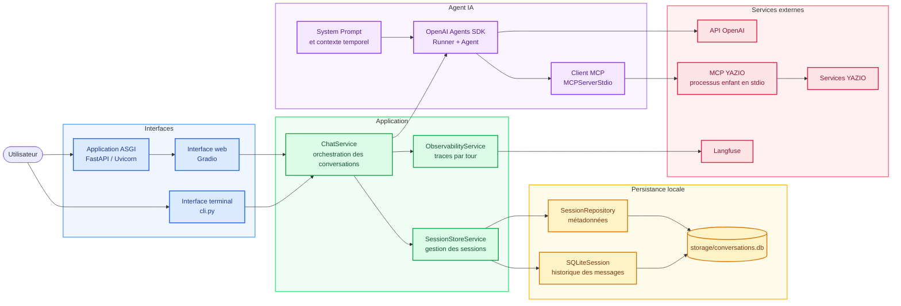

# Agent IA YAZIO

Ce projet vise à créer un petit agent IA avec lequel interagir afin d'exploiter et de compléter les fonctionnalités proposées par le MCP YAZIO.

## Architecture actuelle



`app.py` et `cli.py` assemblent les mêmes services. Le service de conversation
exécute l'agent avec une session persistante, tandis que l'agent appelle les
outils YAZIO via un processus MCP séparé. L'observabilité Langfuse est
optionnelle et se configure par variables d'environnement.

## Lancer l'interface web

Après avoir configuré `.env`, démarrer l'application avec :

```bash
uv run uvicorn app:app --reload
```

Ouvre ensuite [http://localhost:8000](http://localhost:8000). L'application doit
rester sur un seul worker afin de ne démarrer qu'un processus MCP YAZIO.

## Lancer l'interface terminal

Le même service de conversation peut être utilisé sans interface web :

```bash
uv run python cli.py
```

## Observabilité avec Langfuse

Ajouter les identifiants Langfuse dans `.env` :

```env
LANGFUSE_ENABLED=true
LANGFUSE_CAPTURE_CONTENT=true
LANGFUSE_PUBLIC_KEY=pk-lf-remplace-moi
LANGFUSE_SECRET_KEY=sk-lf-remplace-moi
LANGFUSE_BASE_URL=https://cloud.langfuse.com
```

Chaque appel à l'agent crée une trace, regroupée par conversation.
`LANGFUSE_ENABLED=false` désactive Langfuse et
`LANGFUSE_CAPTURE_CONTENT=false` masque le contenu des messages et des outils.
