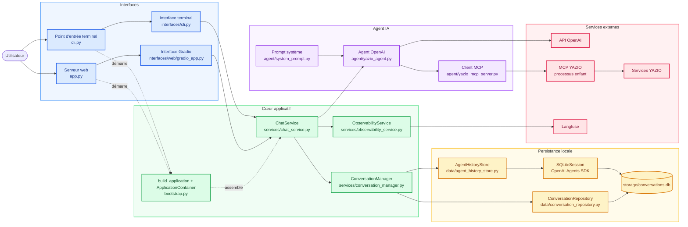

# Agent IA YAZIO

Ce projet vise à créer un petit agent IA avec lequel interagir afin d'exploiter et de compléter les fonctionnalités proposées par le MCP YAZIO.

## Architecture actuelle



Les flèches pleines représentent le flux d'exécution. Les flèches pointillées
représentent uniquement le démarrage : le point d'entrée appelle
`build_application()`, puis `bootstrap.py` construit le graphe de dépendances et
renvoie un `ApplicationContainer`. Une fois l'application lancée, les messages
passent directement de l'interface au `ChatService`, sans repasser par le
bootstrap.

Le container gère aussi le cycle de vie du processus MCP et l'envoi des traces
avant l'arrêt. L'historique et les métadonnées des conversations sont conservés
localement dans SQLite. Langfuse reste facultatif.

## Lancer l'interface web

Configurer `.env`, puis démarrer l'application avec :

```bash
uv run uvicorn app:app --reload
```

Ouvrir ensuite [http://localhost:8000](http://localhost:8000). Conserver un seul
worker afin de ne démarrer qu'un processus MCP YAZIO.

## Lancer l'interface terminal

Le même service de conversation peut être utilisé sans interface web :

```bash
uv run python cli.py
```

## Observabilité avec Langfuse

Ajouter les identifiants Langfuse dans `.env` :

```env
LANGFUSE_ENABLED=true
LANGFUSE_CAPTURE_CONTENT=true
LANGFUSE_PUBLIC_KEY=pk-lf-remplace-moi
LANGFUSE_SECRET_KEY=sk-lf-remplace-moi
LANGFUSE_BASE_URL=https://cloud.langfuse.com
```

Chaque appel à l'agent crée une trace, regroupée par conversation.
`LANGFUSE_ENABLED=false` désactive Langfuse et
`LANGFUSE_CAPTURE_CONTENT=false` masque le contenu des messages et des outils.
